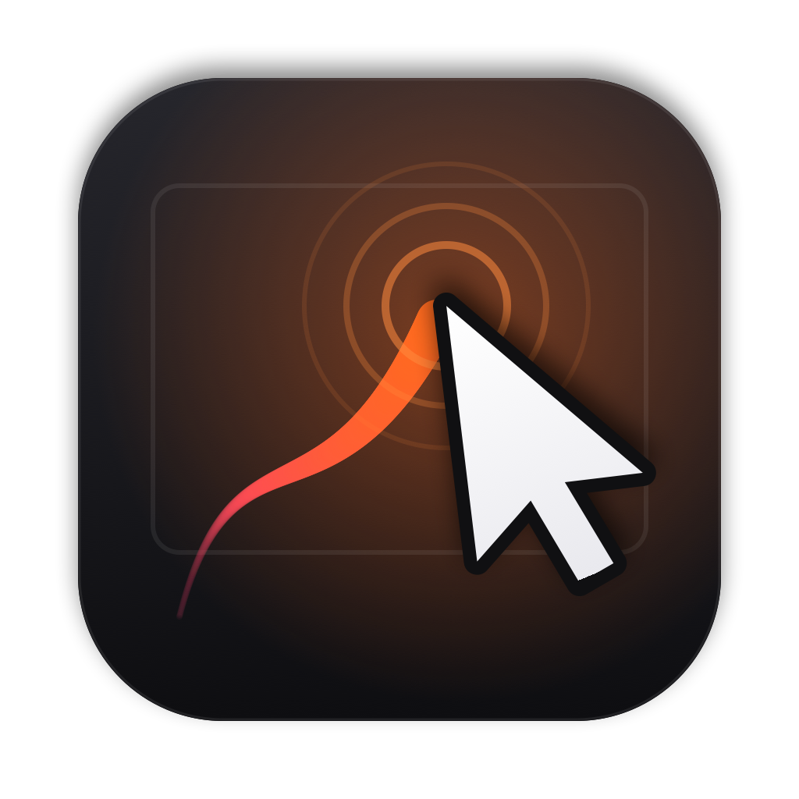
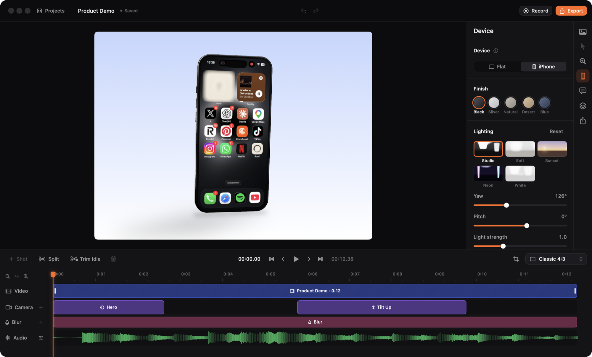
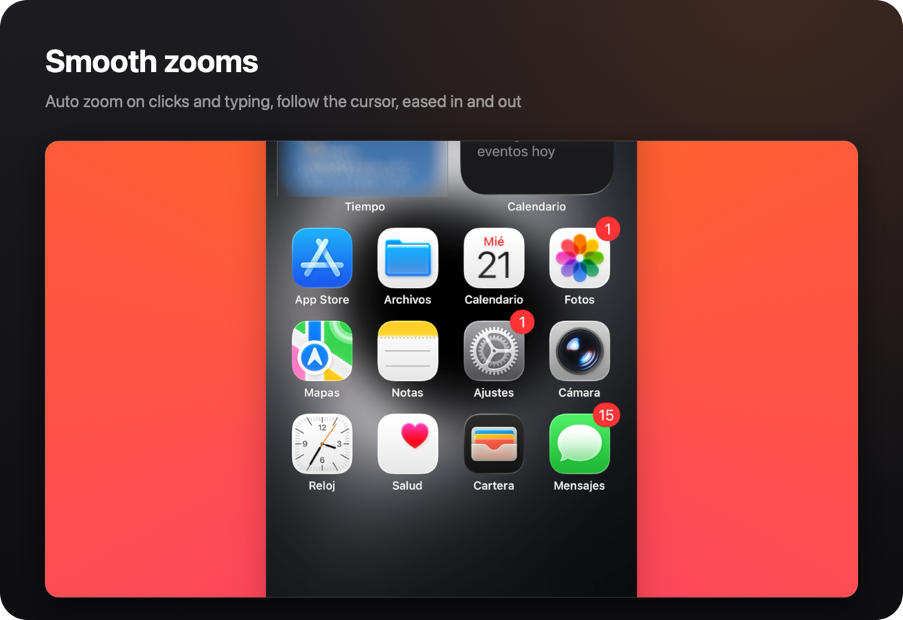
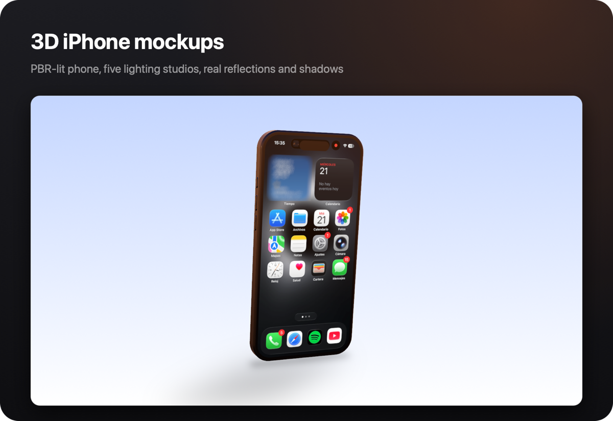
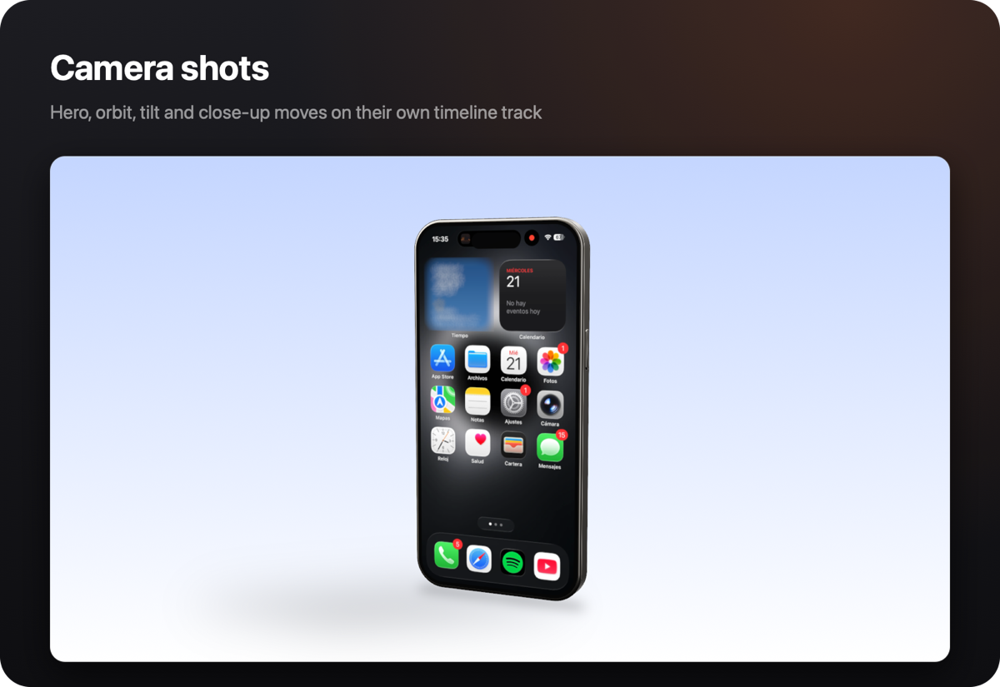
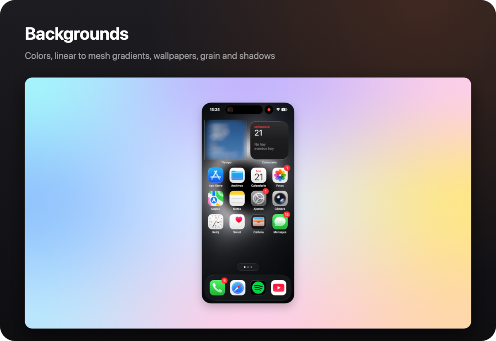
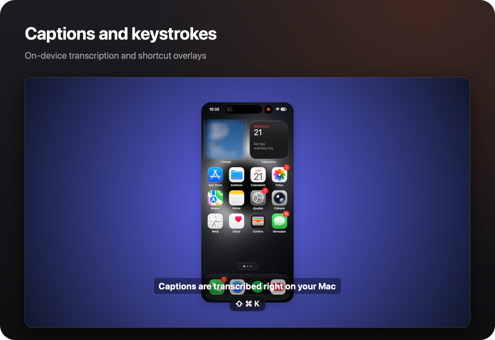
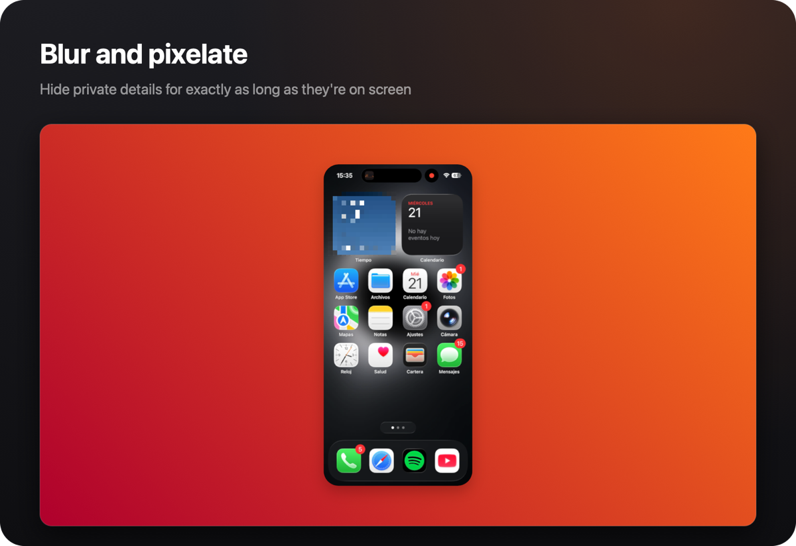

<div align="center">



# Smooth Cursor

### Native macOS screen recording with auto zoom, a buttery cursor and 3D phone mockups

Record your screen, an app window or an iPhone. Smooth Cursor turns the raw capture into a polished, ready-to-post video with no editing skills needed.

</br>

</br>
<sub>The editor: live Metal preview, inspector and timeline</sub>

</div>

---

## Overview

Smooth Cursor is a native macOS screen recorder built around presentation quality. It records your screen with the cursor hidden and logs every movement, click and keystroke at 120 Hz. Then it re-renders the cursor smoothly, zooms in where the action happens and frames the video on a background, or inside a 3D iPhone.

Everything happens on your Mac. The preview and the export use the same GPU renderer, so what you see is exactly what you get.

Built for:

- Product demos and launch videos
- App Store and social media previews
- Coding walkthroughs and tutorials
- Bug reports and UI showcases

---

## Features

<table>
<tr>
<td width="50%"></td>
<td width="50%"></td>
</tr>
<tr>
<td width="50%"></td>
<td width="50%"></td>
</tr>
<tr>
<td width="50%"></td>
<td width="50%"></td>
</tr>
</table>

<table>
<tr>
<th align="left">Capture</th>
<th align="left">Editing</th>
<th align="left">Export</th>
</tr>

<tr>
<td valign="top">

- Display, window or area recording
- iPhone over USB and iOS Simulator
- System audio and microphone tracks
- Webcam overlay
- 120 Hz cursor, click and key telemetry
- Countdown, pause, global hotkeys
- Video import

</td>

<td valign="top">

- Auto zoom from clicks and typing
- Spring-smoothed cursor, custom cursors
- Zoom, camera, blur and audio tracks
- Trim, split and remove idle parts
- Backgrounds, padding, corners, shadow
- 3D iPhone with camera shots
- Captions, keystrokes, blur regions
- Presets and full undo

</td>

<td valign="top">

- H.264, HEVC, ProRes and GIF
- Up to 4K at 60 fps
- Presets for YouTube, X, Reels and more
- Camera and cursor motion blur
- Mixed audio with click sounds
- Hardware encoding, faster than real time
- Background export queue

</td>
</tr>
</table>

> **Requires:** macOS 26 or later

---

## Quick Start

### Run with Xcode

The project is generated with [XcodeGen](https://github.com/yonaskolb/XcodeGen).

```bash
brew install xcodegen
xcodegen generate
open SmoothCursor.xcodeproj
```

Then press **⌘R**.

### Build from the command line

```bash
xcodegen generate && xcodebuild -project SmoothCursor.xcodeproj -scheme SmoothCursor -derivedDataPath build/DerivedData build
```

### Permissions

On first launch, Smooth Cursor asks for:

- **Screen Recording**, to capture the screen
- **Accessibility**, to record keystrokes (optional)
- **Microphone** and **Camera**, for narration and the webcam overlay (optional)

---

## Keyboard shortcuts

| Shortcut | Action |
| --- | --- |
| ⌥⇧⌘R | Start or stop recording |
| ⌥⇧⌘P | Pause or resume recording |
| Space | Play / pause |
| ← / → | Previous / next frame |
| Z | Add a zoom (or a camera shot on the 3D phone) |
| B | Draw a blur region |
| S | Split the clip at the playhead |
| ⌫ | Delete the selection |
| ⌘E | Export |

---

## Project structure

```
App/Sources            SwiftUI app: home, recorder, editor, design system
Packages/SmoothKit
  SCCore               Project model, cursor and camera motion, auto zoom, edits
  SCCapture            ScreenCaptureKit, iPhone capture, input telemetry, webcam
  SCRender             Metal compositor, 3D phone renderer, preview playback
  SCExport             Hardware export, audio mix, GIF, export queue
  SCProject            .smoothcursor packages, autosave, library, captions
```

Package tests:

```bash
cd Packages/SmoothKit && swift test
```

Developer tools: `swift run sc-record`, `swift run sc-render` and `swift run sc-export` record, render a frame and export a project from the command line.
